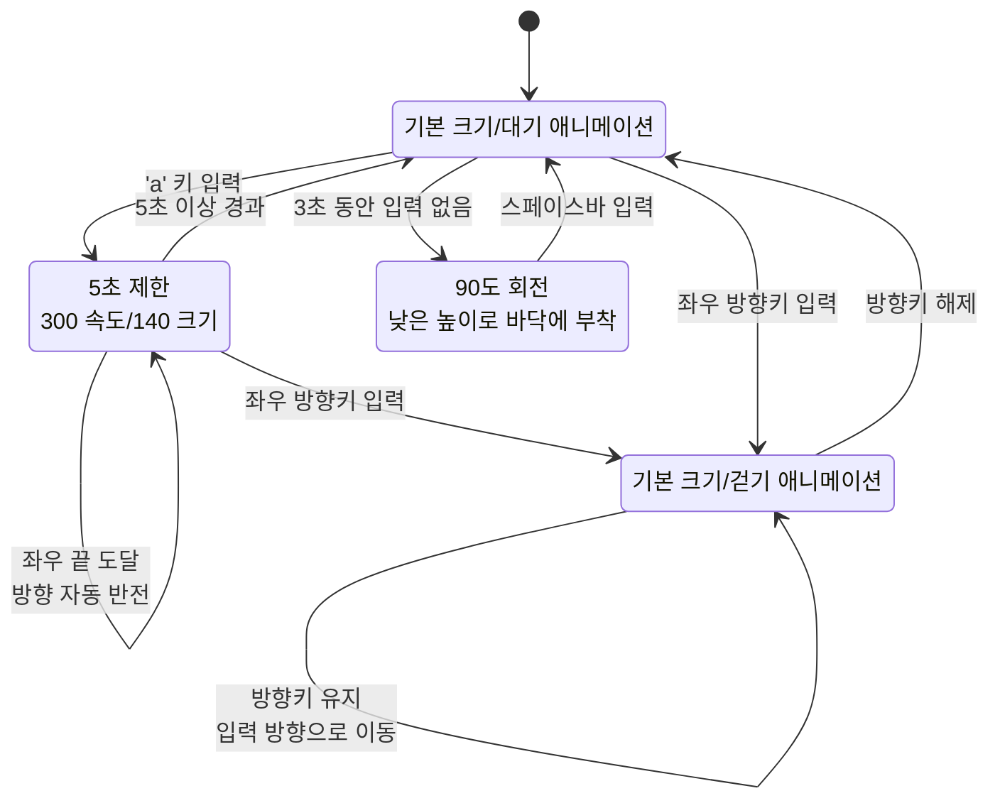

# Character Controller AutoRun PRD

## 1. 문서 개요

- **문서명:** Character Controller AutoRun 기능 개발 기획·요구사항 문서
- **대상 프로그램:** `Labs/LEC12_CharacterController/boy_game.py`
- **작성 목적:** 기존 `IDLE`, `WALK`, `SLEEP` 상태에 자동 무적 런(`AUTORUN`) 상태를 추가하고, `a` 키 입력으로 자동 달리기를 실행한다.
- **현재 기준:** 캐릭터는 좌우 방향키로 `WALK` 상태가 되며, 방향키를 떼면 `IDLE`로 돌아간다. 입력이 없으면 `SLEEP` 상태가 된다.

## 2. 목표

1. `a` 키를 누르면 캐릭터가 `AUTORUN` 상태로 전환된다.
2. `AUTORUN` 상태에서는 방향키 조작 없이도 캐릭터가 계속 좌우로 이동한다.
3. `AUTORUN` 상태에서는 일반 걷기보다 빠르고 크게 표시한다.
4. 화면 좌우 끝에 도달하면 진행 방향을 자동으로 반전한다.
5. `AUTORUN` 상태가 5초 이상 지속되면 `IDLE` 상태로 복귀한다.
6. `AUTORUN` 상태에서 좌우 방향키를 누르면 자동 달리기를 취소하고, 누른 방향의 일반 `WALK` 상태로 전환한다.
7. 자동 달리기 동작을 독립적으로 관리할 수 있도록 `AutoRun` 상태 클래스를 추가한다.

## 3. 범위

### 포함 범위

- `Boy` 상태 머신에 `AUTORUN` 상태 추가
- `AutoRun` 상태 클래스 추가 및 상태 진입/갱신/종료 책임 정의
- `a` 키 입력 처리
- 자동 이동, 속도 증가, 표시 크기 확대, 화면 경계 반전
- 5초 타이머 및 자동 `IDLE` 복귀
- 방향키 입력에 의한 `AUTORUN` 취소 및 `WALK` 전환
- 상태 다이어그램 및 핵심 동작 검증

### 제외 범위

- 새로운 이미지 리소스 제작
- 점프, 공격, 충돌, 체력 시스템
- 카메라 이동 또는 화면 스크롤
- `SLEEP` 상태의 수면 시간 및 애니메이션 정책 변경
- 게임 화면에 상태명/타이머 UI 표시

## 4. 상태 정의

| 상태        | 설명                             | 이동                    | 애니메이션/크기                   |
| ----------- | -------------------------------- | ----------------------- | --------------------------------- |
| `IDLE`    | 제자리 대기                      | 없음                    | 기존 대기 애니메이션, 기본 크기   |
| `WALK`    | 방향키를 누르는 동안 이동        | 입력 방향               | 기존 걷기 애니메이션, 기본 크기   |
| `SLEEP`   | 일정 시간 입력이 없을 때 수면    | 없음                    | 기존 수면 자세, 90도 회전         |
| `AUTORUN` | `a` 키로 시작하는 자동 무적 런 | 현재 방향으로 자동 이동 | 걷기/달리기 애니메이션, 확대 크기 |

`AUTORUN`은 일반 `WALK`와 별도의 상태로 관리하며, 자동 이동 방향은 `face_dir`를 사용한다.

## 5. 사용자 입력 요구사항

### 5.1 `a` 키

- `IDLE` 상태에서 `a` 키를 누르면 `AUTORUN`으로 전환한다.
- `a` 키의 반복 입력으로 속도나 크기가 중복해서 증가하지 않아야 한다.
- `WALK` 또는 `SLEEP` 상태에서의 `a` 키 동작은 기존 상태와 충돌하지 않도록 명시된 정책을 따른다.
  - 1차 구현 권장 정책: `IDLE`에서만 `AUTORUN`을 시작한다.

### 5.2 좌우 방향키

- `AUTORUN` 상태에서 `LEFT` 또는 `RIGHT` 키를 누르면:
  1. `AUTORUN`을 즉시 취소한다.
  2. 누른 방향을 `face_dir`에 반영한다.
  3. 일반 `WALK` 상태로 전환한다.
- 방향키를 누르지 않는 동안에는 `AUTORUN`이 계속 자동 이동한다.
- 일반 `WALK` 상태의 기존 키 다운/업 동작은 유지한다.
- `ESC` 키는 기존처럼 게임 종료에 사용한다.

## 6. 자동 달리기 동작 요구사항

### 6.1 이동

- `AUTORUN` 진입 시 현재 바라보는 방향으로 이동을 시작한다.
- 이동 방향은 `face_dir = -1`이면 왼쪽, `face_dir = 1`이면 오른쪽이다.
- 이동은 프레임 수가 아니라 경과 시간(`elapsed_time`)을 기준으로 계산한다.
- 화면 밖으로 이동하지 않는다.

### 6.2 속도

- 일반 걷기 속도와 자동 달리기 속도를 별도 상수로 관리한다.
- 자동 달리기 속도는 일반 걷기 속도보다 커야 한다.
- 권장 초기값:

```python
WALK_SPEED = 150
AUTORUN_SPEED = 300
```

### 6.3 크기

- `AUTORUN` 상태에서만 렌더링 크기를 확대한다.
- 기본 스프라이트 표시 크기: `100 x 100`
- 권장 자동 달리기 표시 크기: `140 x 140`
- 확대된 크기를 기준으로 화면 경계를 계산해 캐릭터 일부가 화면 밖으로 나가지 않도록 한다.
- 상태 종료 시 표시 크기는 기본 크기로 복원한다.

### 6.4 화면 끝 자동 방향 전환

- 캐릭터의 중심 좌표가 확대된 스프라이트의 반쪽 크기를 고려한 왼쪽 경계에 도달하면 오른쪽으로 전환한다.
- 오른쪽 경계에 도달하면 왼쪽으로 전환한다.
- 방향 전환 시 `face_dir`를 갱신하고 다음 프레임부터 반대 방향 애니메이션을 사용한다.
- 자동 방향 전환은 `AUTORUN` 상태에서만 적용한다.

### 6.5 지속 시간

- `AUTORUN` 진입 시 자동 달리기 경과 시간을 `0`으로 초기화한다.
- `AUTORUN` 상태에서 매 프레임 경과 시간을 누적한다.
- 누적 시간이 `5.0초 이상`이면 자동으로 `IDLE`로 전환한다.
- `IDLE` 전환 시 자동 달리기 타이머와 확대 표시를 초기화한다.

## 7. `AutoRun` 상태 클래스 요구사항

`AutoRun` 상태 클래스는 자동 달리기 동작을 한 곳에서 관리해야 한다.

### 책임

- 상태 진입 시 타이머 초기화
- 자동 이동 방향과 속도 계산
- 좌우 화면 경계 확인 및 방향 반전
- 자동 달리기 경과 시간 갱신
- 상태 종료 시 기본 크기 복원
- 방향키 입력 시 일반 `WALK` 상태로 넘길 수 있는 종료 처리

### 권장 인터페이스

구현 방식은 기존 `transitions.Machine` 구조와 호환되어야 하며, 다음과 같은 역할을 제공한다.

```python
class AutoRun:
    def enter(self, boy):
        ...

    def update(self, boy, elapsed_time):
        ...

    def exit(self, boy):
        ...
```

`AutoRun`을 `Machine`의 상태 콜백에서 사용하는 방식 또는 상태 객체를 `Boy`에 보유하는 방식 중 하나를 선택할 수 있다. 단, 자동 달리기 로직이 `boy_game.py`의 이벤트 루프에 중복 구현되어서는 안 된다.

## 8. 상태 전이

| 현재 상태   | 이벤트/조건         | 다음 상태   | 처리                                |
| ----------- | ------------------- | ----------- | ----------------------------------- |
| `IDLE`    | `a` 키 입력       | `AUTORUN` | 타이머 초기화, 확대, 자동 이동 시작 |
| `AUTORUN` | 5초 이상 경과       | `IDLE`    | 자동 달리기 종료, 기본 크기 복원    |
| `AUTORUN` | 왼쪽 방향키 입력    | `WALK`    | 자동 달리기 취소, 왼쪽 이동 시작    |
| `AUTORUN` | 오른쪽 방향키 입력  | `WALK`    | 자동 달리기 취소, 오른쪽 이동 시작  |
| `AUTORUN` | 화면 왼쪽 끝 도달   | `AUTORUN` | 방향을 오른쪽으로 반전              |
| `AUTORUN` | 화면 오른쪽 끝 도달 | `AUTORUN` | 방향을 왼쪽으로 반전                |
| `WALK`    | 방향키 해제         | `IDLE`    | 기존 동작 유지                      |
| `IDLE`    | 3초 동안 입력 없음  | `SLEEP`   | 기존 수면 동작 유지                 |
| `SLEEP`   | 스페이스바 입력     | `IDLE`    | 수면 상태 해제                      |

## 9. 상태 다이어그램



### 최신 상태 동작 요약

- `IDLE`에서 `a` 키를 누르면 현재 방향으로 `AUTORUN`을 시작한다.
- `AUTORUN`은 방향키 입력 없이 `SPEED=300`으로 이동하고 `SIZE=140`으로 확대 표시한다.
- 오토런 캐릭터의 중심은 확대 크기를 고려해 화면 좌우 `70~730` 범위에 머물며, 끝에 도달하면 방향을 반전한다.
- `AUTORUN`이 5초 이상 지속되면 `IDLE`로 복귀하고 타이머를 초기화한다.
- `AUTORUN` 중 좌우 방향키를 누르면 자동 이동을 취소하고 해당 방향의 `WALK`으로 전환한다.
- `WALK`에서 방향키를 떼면 `IDLE`로 복귀한다.
- `IDLE`에서 3초 동안 입력이 없으면 `SLEEP`이 되며, 스페이스바로만 깨어난다.

## 10. 수용 기준

구현 후 다음 조건을 모두 만족해야 한다.

1. `IDLE` 상태에서 `a` 키를 누르면 상태가 `AUTORUN`이 된다.
2. `AUTORUN` 상태에서 키를 추가로 누르지 않아도 캐릭터가 계속 이동한다.
3. `AUTORUN` 속도가 `WALK` 속도보다 빠르다.
4. `AUTORUN` 상태의 캐릭터 표시 크기가 기본 상태보다 크다.
5. 캐릭터가 화면의 왼쪽 끝에 닿으면 오른쪽으로 이동 방향이 바뀐다.
6. 캐릭터가 화면의 오른쪽 끝에 닿으면 왼쪽으로 이동 방향이 바뀐다.
7. `AUTORUN` 진입 후 5초 이상 지나면 `IDLE`로 돌아간다.
8. `AUTORUN` 중 왼쪽 방향키를 누르면 자동 달리기가 취소되고 왼쪽 `WALK`이 시작된다.
9. `AUTORUN` 중 오른쪽 방향키를 누르면 자동 달리기가 취소되고 오른쪽 `WALK`이 시작된다.
10. `AUTORUN` 종료 후 속도, 크기, 타이머가 일반 상태의 값으로 복원된다.
11. 기존 `IDLE`, `WALK`, `SLEEP` 기능과 `ESC` 종료 기능이 유지된다.
12. 문법 검사와 상태 전이 단위 테스트가 통과한다.

## 11. 테스트 계획

### 단위 테스트

- `a` 입력 후 상태가 `AUTORUN`인지 확인
- `AUTORUN` 진입 시 타이머가 0인지 확인
- 자동 달리기 속도가 일반 걷기 속도보다 큰지 확인
- 자동 달리기 표시 크기가 기본 크기보다 큰지 확인
- 5초 미만에는 `AUTORUN`이 유지되는지 확인
- 5초 이상에는 `IDLE`로 전환되는지 확인
- 좌우 화면 경계에서 방향이 반전되는지 확인
- `AUTORUN` 중 좌우 방향키 입력 시 `WALK`으로 전환되는지 확인
- `AUTORUN` 종료 후 기본 크기와 속도가 복원되는지 확인

### 회귀 테스트

- 좌우 방향키를 누르고 있는 동안 `WALK`이 유지되는지 확인
- 방향키를 떼면 `IDLE`로 복귀하는지 확인
- 입력 없이 3초 경과 시 `SLEEP`으로 전환되는지 확인
- `SLEEP`에서 스페이스바 입력 시 정상적으로 깨어나는지 확인
- `SLEEP`에서 방향키나 다른 키 입력만으로 깨어나지 않는지 확인
- `ESC` 입력 시 게임이 종료되는지 확인

## 12. 구현 전 결정 사항

- 본 문서의 권장 기본값은 `AUTORUN_SPEED = 300`, `AUTORUN_SIZE = 140`, `AUTORUN_DURATION = 5.0초`이다.
- 실제 스프라이트 시트에 별도 달리기 행이 있으면 해당 행을 우선 사용한다.
- 별도 달리기 행이 없으면 기존 걷기 프레임을 더 빠른 속도로 재생해 자동 달리기 애니메이션으로 사용한다.
- `a` 키의 키 코드는 프로젝트에서 사용하는 `pico2d` 상수 또는 기존 키 코드 처리 방식에 맞춰 구현한다.
